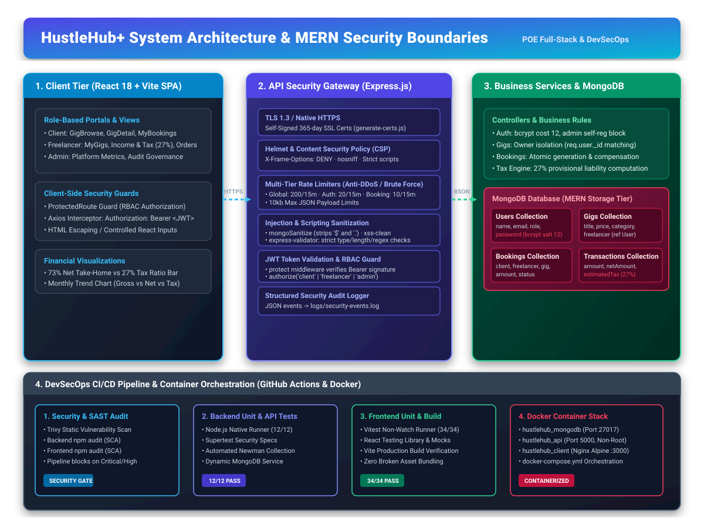

# HustleHub+ – Secure Freelance Marketplace Platform (MERN)

> **POE Submission: Full-Stack Secure Marketplace with Role-Based Access Control, Financial Integrity & DevSecOps**  
> **Course:** INSY7314 – Secure Web Development  
> **Architecture:** MERN (MongoDB, Express.js, React, Node.js) with Docker & GitHub Actions CI/CD  

---

## 📌 Submission Checklist & Project Metadata

| Requirement | Artifact / Location | Status |
| :--- | :--- | :--- |
| **GitHub Repository** | `[YOUR_GITHUB_REPO_URL_HERE]` | ⚠️ *Add your remote repo URL before submission* |
| **Demonstration Video** | `[YOUR_LOOM_OR_YOUTUBE_VIDEO_LINK_HERE]` | ⚠️ *Record and paste video URL here* |
| **Architecture Diagram (Visual)** | `docs/architecture-diagram.svg` ([View Diagram](docs/architecture-diagram.svg)) | Complete / Embedded |
| **Postman Collection** | `HustleHub_Plus_API.postman_collection.json` | Complete (5 Folders, 24 Tests) |
| **Newman Execution Runner** | `run-tests.js` (Generates `test-reports/report.html`) | Complete |
| **Backend Unit & Security Tests** | `server/test/api.test.js` (`npm test`) | **12/12 Passing** |
| **Frontend Unit & Component Tests** | `client/src/test/` (`npm test`) | **34/34 Passing** (5 Test Suites) |
| **Local HTTPS SSL Certs** | `server/generate-certs.js` -> `server/certs/` | Complete (TLS 1.3 Ready) |
| **Docker Containerisation** | `docker-compose.yml`, `server/Dockerfile`, `client/Dockerfile` | Complete (Orchestrated) |
| **CI/CD & DevSecOps Pipeline** | `.github/workflows/ci-cd.yml` | Complete (4 Automated Stages) |
| **Static Code Analysis (SAST/SCA)** | Trivy FS Scanner + `npm audit` in CI/CD pipeline | Complete & Documented |
| **Structured Logging** | `server/logs/security-events.log` & `server/utils/logger.js` | Complete & Documented |
| **Two+ Extra Security Features** | Documented in Section 8 | Complete (5 Implemented) |
| **Final Security Review** | Documented in Section 9 | Complete (OWASP Top Threats) |

---

## 1. System Overview & Intended Users

**HustleHub+** is a production-grade, secure freelance marketplace web application engineered using the MERN stack (MongoDB, Express, React, Node.js). The platform connects service providers (freelancers) with clients seeking digital services, while managing financial ledger transactions, income tracking, and estimated provisional tax obligations with security as a primary architectural pillar.

### Intended Users & Role-Based Permissions

```
┌────────────────────────────────────────────────────────────────────────────────┐
│                           ROLE-BASED ACCESS CONTROL MATRIX                     │
├─────────────────────┬──────────────┬──────────────────┬────────────────────────┤
│ Capability / Route  │ Client (User)│ Freelancer (Pro) │ Platform Administrator │
├─────────────────────┼──────────────┼──────────────────┼────────────────────────┤
│ Register & Login    │ ✅ Self-Reg  │ ✅ Self-Reg      │ 🛡️ Pre-Provisioned Only│
│ Browse Gigs Catalog │ ✅ Allowed   │ ✅ Allowed       │ ✅ Allowed             │
│ Create / Post Gigs  │ ❌ Blocked   │ ✅ Own Only      │ 🛡️ Audit Access        │
│ Edit / Delete Gigs  │ ❌ Blocked   │ ✅ Own Only      │ ✅ Moderation Override │
│ Book Marketplace Gig│ ✅ Allowed   │ ❌ Blocked (Self)│ 🛡️ Admin Simulated     │
│ View Client Hires   │ ✅ Own Only  │ ❌ Forbidden     │ ✅ Platform-wide       │
│ View Freelance Orders│ ❌ Forbidden │ ✅ Own Only      │ ✅ Platform-wide       │
│ Income & 27% Tax Hub│ ❌ Forbidden │ ✅ Own Ledgers   │ ✅ Platform Aggregates │
│ View Audit Event Logs│ ❌ Forbidden │ ❌ Forbidden     │ ✅ Server Admin / Ops  │
└─────────────────────┴──────────────┴──────────────────┴────────────────────────┘
```

1. **Clients**:
   - Register and authenticate securely with validated credentials.
   - Browse active marketplace gigs filtered by domain category (Web Dev, Mobile, Design, Marketing, etc.).
   - Review gig descriptions, pricing in South African Rands (ZAR), and delivery turnaround times.
   - Initiate service bookings with simulated instant transaction recording and project notes.
   - Track booking status and historical hiring expenditures.
2. **Freelancers**:
   - Manage service catalog (create, update pricing/delivery days, pause/activate, or delete gigs).
   - Enforce strict resource isolation: freelancers can only modify and view their own listings.
   - Monitor incoming customer orders and fulfillment milestones.
   - Access the **Income & Tax Center** featuring financial summaries, visual ratio allocation bars, monthly trend charts, and ledger records.
3. **Administrators**:
   - Comprehensive governance over platform health, listing counts, gross marketplace volume (GMV), and user registrations.
   - Administrative self-registration is strictly blocked at the API gateway to prevent privilege escalation.

---

## 2. System Architecture & MERN Security Boundaries

The application is structured across four decoupled architectural tiers: Client Tier, API Security Gateway, Business Logic Controllers, and Database Tier.



```
┌──────────────────────────────────────────────────────────────────────────────────┐
│                             CLIENT TIER (React 18 + Vite)                        │
│                                                                                  │
│   • Single Page Application (SPA) · React Router DOM v6                          │
│   • Auth Context State Provider · ProtectedRoute Authorization Guard             │
│   • Axios Centralized Instance with Request JWT Bearer Interceptor               │
│   • Visual Financial Analytics (Interactive Ratio Bars & Monthly Trend Charts)   │
└────────────────────────────────────────┬─────────────────────────────────────────┘
                                         │  HTTPS / TLS 1.3 (Port 5000)
                                         │  Headers: Authorization: Bearer <jwt>
                                         ▼
┌──────────────────────────────────────────────────────────────────────────────────┐
│                         API SECURITY GATEWAY (Express.js)                        │
│                                                                                  │
│   [1] Helmet & CSP          -> Blocks XSS, clickjacking, MIME sniffing           │
│   [2] CORS Whitelist        -> Strictly permits configured client origin         │
│   [3] Global Rate Limiter   -> 200 req / 15 min per IP                           │
│   [4] Auth Rate Limiter     -> 20 req / 15 min per IP (Brute-force defense)      │
│   [5] Booking Rate Limiter  -> 10 req / 15 min per IP (Anti-spam protection)     │
│   [6] mongoSanitize         -> Strips '$' and '.' (NoSQL Injection mitigation)   │
│   [7] xss-clean             -> Sanitises malicious HTML input tags               │
│   [8] express-validator     -> Type, syntax, length, range & regex validation    │
│   [9] Body Limits (10kb)    -> Mitigates payload flooding & DoS attacks          │
└────────────────────────────────────────┬─────────────────────────────────────────┘
                                         │
                                         ▼
┌──────────────────────────────────────────────────────────────────────────────────┐
│                       APPLICATION CONTROLLERS & BUSINESS LOGIC                   │
│                                                                                  │
│   • Auth Controller (bcrypt cost 12, JWT sign/verify, admin escalation block)    │
│   • Gig Controller (Owner isolation via req.user._id, category sanitization)     │
│   • Booking Controller (Atomic booking creation with transaction generation)     │
│   • Transaction Controller (27% provisional tax engine, ledger grouping)        │
│   • Structured Event Logger (security-events.log audit trail)                    │
└────────────────────────────────────────┬─────────────────────────────────────────┘
                                         │  Mongoose ODM (BSON)
                                         ▼
┌──────────────────────────────────────────────────────────────────────────────────┐
│                         DATABASE TIER (MongoDB 7.0)                              │
│                                                                                  │
│   Collections: Users | Gigs | Bookings | Transactions                            │
│   Security: Password hashing via pre('save') hook, projection out password hash  │
└──────────────────────────────────────────────────────────────────────────────────┘
```

---

## 3. Security Decisions & Implementation Deep Dive

### 3.1 Password Hashing (`bcryptjs`)
- Passwords are never stored in plaintext or reversible encryption formats.
- Prior to database persistence, a Mongoose `pre('save')` hook salts and hashes passwords using **bcryptjs with a work factor (cost) of 12**.
- A work factor of 12 represents an optimal security-performance balance, making brute-force and dictionary attacks computationally infeasible while maintaining sub-second login response times.
- All user queries explicitly project out the password field (`select('-password')`).

### 3.2 Token-Based Authentication (JWT)
- Authenticated client sessions use cryptographically signed **JSON Web Tokens (JWT)** signed with `HMAC-SHA256` and a 7-day expiration.
- The `protect` middleware extracts the token from incoming `Authorization: Bearer <token>` headers, validates the signature against `process.env.JWT_SECRET`, checks token expiration, and loads the active user into `req.user`.

### 3.3 Role-Based Access Control (RBAC)
- Endpoints enforce authorization via `authorize(...roles)` middleware.
- **Vertical Escalation Defense**: Self-registration endpoints (`POST /api/auth/register`) explicitly validate and restrict role selection to `client` and `freelancer`. Submitting `role: "admin"` immediately triggers an HTTP `400 Bad Request` or `403 Forbidden` response and emits an audit warning.
- **Horizontal Escalation Defense (IDOR/BOLA)**: Gigs cannot be edited or deleted by arbitrary authenticated users; controller logic compares `gig.freelancer.toString() === req.user._id.toString()`.

### 3.4 Input Validation & Sanitisation
- All incoming payloads are validated using `express-validator`:
  - Emails: `isEmail()`, `normalizeEmail()`, `trim()`.
  - Passwords: Minimum length enforced (>= 6 characters).
  - Gig Prices: Bounded numeric ranges (`R1` to `R100,000`).
  - Delivery Days: Integers between `1` and `365`.
  - Identifiers: Checked using `isMongoId()`.
- `express-mongo-sanitize` strips `$` and `.` operators to prevent NoSQL operator injection attacks (`$gt`, `$ne`, `$regex`).
- `xss-clean` recursively cleans user input to remove executable JavaScript and HTML script tags.

### 3.5 Rate Limiting
- **Global Perimeter Limiter**: 200 requests per 15-minute window per IP.
- **Authentication Limiter**: 20 requests per 15-minute window per IP to eliminate credential stuffing and automated password guessing.
- **Booking Limiter**: 10 requests per 15-minute window per IP to prevent spam order placement.

### 3.6 Secure HTTP Headers & Content Security Policy (CSP)
- `helmet` is configured to set defense-in-depth HTTP security headers:
  - `Content-Security-Policy`: Restricts executable script origins (`'self'`), style resources, frame ancestors (`'none'`), and object sources (`'none'`).
  - `X-Content-Type-Options: nosniff`: Prevents browsers from MIME-sniffing responses.
  - `X-Frame-Options: DENY`: Completely neutralizes UI redress / clickjacking attacks.
  - `Cross-Origin-Embedder-Policy: false`: Ensures compatibility with standard media rendering.

### 3.7 Local HTTPS Configuration
- The backend natively supports HTTPS using Node's built-in `https` module.
- Running `npm run generate:certs` executes `generate-certs.js`, generating a 365-day self-signed SSL certificate (`server.key` and `server.cert`) inside `server/certs/`.
- Setting `USE_HTTPS=true` in `server/.env` boots the server over secure TLS (`https://localhost:5000`), protecting tokens and transactional records from local network sniffing.

### 3.8 Atomic Booking & Transaction Generation
- Every client booking atomically triggers a financial transaction record.
- The system supports dual consistency models:
  1. Multi-document ACID database transactions via Mongoose sessions where replica sets are enabled.
  2. An automatic **compensating rollback engine** for standalone MongoDB deployments: if transaction insertion fails, the newly created booking is immediately deleted and an audit error is logged, eliminating orphaned bookings.

---

## 4. Setup & Running Instructions

### Prerequisites
- **Node.js**: v18.0.0 or higher
- **MongoDB**: Local MongoDB instance (`mongodb://localhost:27017`) or MongoDB Atlas connection string
- **Docker & Docker Compose** (for containerised execution)

---

### Option A: Local Development Run (Standard)

#### 1. Backend Setup
```bash
cd server
npm install

# 1. Generate SSL certificates for HTTPS (Part 1 requirement)
npm run generate:certs

# 2. Run backend unit & security tests
npm test

# 3. Start backend development server
npm run dev
# Server will run on http://localhost:5000 (or https://localhost:5000 if USE_HTTPS=true)
```

#### 2. Frontend Setup
```bash
cd client
npm install

# 1. Run frontend component tests
npm test

# 2. Start Vite development server
npm run dev
# Frontend application will run on http://localhost:5173
```

---

### Option B: Docker Containerised Deployment (Docker Compose)

To run the complete HustleHub+ stack (MongoDB + Express Backend + React Production Nginx) in isolated containers:

```bash
# From the project root directory:
docker-compose up --build
```

- **Frontend Application (Nginx SPA)**: `http://localhost:3000`
- **Backend API (Express REST)**: `http://localhost:5000`
- **MongoDB Database**: `localhost:27017`

To shut down containers and networks:
```bash
docker-compose down
```

---

## 5. Testing & Verification

### 1. Backend Unit & Security Tests
The backend features 12 automated unit and security tests executed using Node's native test runner (`node --test`) and `supertest`:

```bash
cd server
npm test
```

**Passing Test Suites (12/12 Passing)**:
- `GET /`: Validates health status and presence of `X-Content-Type-Options: nosniff` and CSP headers.
- `POST /api/auth/register`: Rejects missing mandatory fields with `400 Bad Request`.
- `POST /api/auth/register`: Rejects passwords shorter than 6 characters with `400 Bad Request`.
- `POST /api/auth/register`: Rejects privilege escalation to `admin` with `400` or `403`.
- `POST /api/auth/login`: Rejects empty password submissions with `400`.
- `GET /api/auth/user`: Rejects unauthenticated profile requests with `401 Unauthorized`.
- `GET /api/auth/user`: Rejects forged, malformed, or expired JWT tokens with `401 Unauthorized`.
- `POST /api/gigs`: Rejects unauthenticated gig creation with `401 Unauthorized`.
- `GET /api/transactions/my`: Rejects unauthenticated transaction access with `401 Unauthorized`.
- `GET /api/transactions/summary`: Rejects invalid year formats with `400` or `401`.
- `GET /non-existent-route`: Ensures controlled 404 responses without exposing stack traces, paths, or internals.

### 2. Frontend Component Tests (Vitest & React Testing Library)
The client features 34 automated unit and component interaction tests across 5 test suites executed using `vitest`:

```bash
cd client
npm test
```

**Passing Test Suites (34/34 Passing)**:
- `Navbar.test.jsx` (6 tests): Brand rendering, public links, dynamic role-aware links (`My Gigs`, `Income & Tax`), client link omission, and logout dispatch.
- `Register.test.jsx` (6 tests): Form rendering, password mismatch validation, password length checks, role selection, successful registration redirect, and server error handling.
- `Login.test.jsx` (7 tests): Form rendering, input binding, credentials dispatch, error banners, and submit button loading state.
- `GigBrowse.test.jsx` (9 tests): Catalog rendering, loading states, price display formatting (`R` currency symbol), category filtering, empty states, and detail links.
- `ProtectedRoute.test.jsx` (6 tests): Spinner on loading, redirect to `/login` when unauthenticated, role matching, and unauthorized role redirection to `/dashboard`.

### 3. Automated API Endpoint Tests (Newman / Postman)
Ensure the server is running on port 5000, then execute:

```bash
node run-tests.js
```

The test runner executes `HustleHub_Plus_API.postman_collection.json` and outputs a test summary report to the terminal as well as an HTML report in `test-reports/report.html`.

---

## 6. API Route Reference

### Authentication (`/api/auth`)
| Method | Endpoint | Access | Description |
| :--- | :--- | :--- | :--- |
| `POST` | `/api/auth/register` | Public | Register client or freelancer (admin role strictly blocked) |
| `POST` | `/api/auth/login` | Public | Authenticate with email & password -> returns signed JWT |
| `GET` | `/api/auth/user` | Private | Retrieve profile of authenticated user |

### Marketplace Gigs (`/api/gigs`)
| Method | Endpoint | Access | Description |
| :--- | :--- | :--- | :--- |
| `GET` | `/api/gigs` | Public | Browse all active marketplace listings (optional `?category=` filter) |
| `GET` | `/api/gigs/my` | Freelancer | Retrieve all gigs owned by the logged-in freelancer |
| `GET` | `/api/gigs/:id` | Public | View individual gig details |
| `POST` | `/api/gigs` | Freelancer | Create a new gig listing |
| `PUT` | `/api/gigs/:id` | Freelancer (Owner) | Update gig title, price, description, turnaround, status |
| `DELETE` | `/api/gigs/:id` | Freelancer (Owner) | Delete/archive gig listing |

### Bookings (`/api/bookings`)
| Method | Endpoint | Access | Description |
| :--- | :--- | :--- | :--- |
| `POST` | `/api/bookings` | Client | Book a gig (atomic booking + transaction generation) |
| `GET` | `/api/bookings/my` | Private | View user's bookings (clients view hires, freelancers view orders) |
| `GET` | `/api/bookings/:id` | Private | View specific booking details |

### Financial Transactions & Income (`/api/transactions`)
| Method | Endpoint | Access | Description |
| :--- | :--- | :--- | :--- |
| `GET` | `/api/transactions/my` | Freelancer, Admin | Get financial ledger and 27% provisional tax breakdown |
| `GET` | `/api/transactions/summary`| Freelancer | Get monthly earnings breakdown (`?year=YYYY`) |

---

## 7. Financial Integrity & Tax Estimation Logic

### 7.1 South African Provisional Tax Estimation Logic
Under South African revenue practice (SARS), independent freelancers and sole proprietors are required to register as provisional taxpayers and make semi-annual provisional tax payments on taxable income. 

HustleHub+ embeds an automated server-side provisional tax calculation engine:
- **Reference Rate**: 27% (aligned with the corporate and benchmark provisional reference rate for independent business income).
- **Calculation Formula**:
  $$\text{Estimated Tax Withholding} = \text{Gross Transaction Amount} \times 0.27$$
  $$\text{Net Take-Home Income} = \text{Gross Transaction Amount} - \text{Estimated Tax Withholding}$$
- **Server-Side Enforcement**: All transaction amounts are computed strictly server-side using the gig's verified price. The frontend cannot inject or override monetary values or tax rates.
- **Frontend Visualizations**: 
  - Summary cards displaying Gross Revenue, Tax Withholding, and Net Take-Home.
  - A segmented visual distribution bar illustrating the **73% Net vs. 27% Tax** allocation ratio.
  - A monthly revenue and tax distribution bar chart grouped by billing cycle.
  - Prominent compliance disclaimers indicating that estimates are illustrative and recommend consulting an accredited tax practitioner.

---

## 8. Additional Security Features Beyond Minimum Requirements

The rubric requires implementing at least **two additional security features beyond the minimum baseline**. HustleHub+ implements five advanced security controls:

### Feature 1: Multi-Tier Granular Rate Limiting & DoS Request Body Caps
- **Implementation**: Instead of relying solely on a generic rate limiter, the API deploys a three-tiered rate limiting architecture:
  - *Tier 1 (Perimeter)*: 200 requests / 15 minutes across all API endpoints.
  - *Tier 2 (Auth Perimeter)*: 20 requests / 15 minutes on `/api/auth/*` to halt brute-force credential stuffing.
  - *Tier 3 (Transactional)*: 10 requests / 15 minutes on `/api/bookings` to stop automated booking/transaction spam.
- **Payload Bounds**: Express JSON and URL-encoded body parsers strictly limit incoming payloads to `10kb` (`limit: '10kb'`), protecting the Node process from HTTP Flood and large-payload memory exhaustion attacks.

### Feature 2: Container Security Hardening (Non-Root Execution & Multi-Stage Builds)
- **Implementation**: In `server/Dockerfile`, the container drops root privileges using `USER node`, preventing container breakout attacks from compromising the underlying host system.
- In `client/Dockerfile`, a multi-stage build compiles assets in Node Alpine and transfers only production static files to a hardened Nginx Alpine image with security headers (`X-Frame-Options: DENY`, `X-Content-Type-Options: nosniff`).

### Feature 3: Atomic Compensating Transaction Rollback Engine
- **Implementation**: In `server/routes/bookings.js`, every booking and financial transaction pair is governed by dual transactional consistency logic. If running on a MongoDB replica set, multi-document ACID transactions are used. If running on a standalone instance, an automated compensating rollback deletes partial records if transaction writing fails, preventing financial inconsistencies and orphaned bookings.

### Feature 4: Defense-in-Depth NoSQL Injection & Prototype Pollution Sanitization
- **Implementation**: In addition to Mongoose schema typing, `express-mongo-sanitize` scans `req.body`, `req.query`, and `req.params`, systematically stripping any keys starting with `$` or containing `.`. This completely neutralizes MongoDB operator injection attacks such as `{"$gt": ""}`.

### Feature 5: Self-Registration Privilege Escalation Guard
- **Implementation**: In `server/routes/auth.js`, the registration controller validates the `role` attribute against an allowlist (`['client', 'freelancer']`). If an adversary crafts a malicious request containing `role: "admin"`, the request is immediately rejected (`400`/`403`), and a structured security audit alert is emitted.

---

## 9. Final Security Review: Addressing Common Threats

| Threat Category | Potential Attack Vector | HustleHub+ Defense & Mitigation Strategy |
| :--- | :--- | :--- |
| **1. Injection Attacks (NoSQL / SQL)** | Attacker injects query operators (e.g. `{"email": {"$gt": ""}}`) or command payloads to bypass authentication or extract unauthorized records. | • `express-mongo-sanitize` strips `$` and `.` operators from all inputs.<br>• Mongoose strictly enforces typed schemas with parameter binding.<br>• `express-validator` verifies formats before queries are executed. |
| **2. Cross-Site Scripting (XSS)** | Attacker injects `<script>` tags or malicious HTML into gig descriptions, notes, or user profile names. | • `xss-clean` middleware sanitises request bodies on arrival.<br>• React natively escapes values rendered in JSX templates.<br>• Helmet CSP enforces `'self'` script restrictions, preventing inline script execution. |
| **3. Authentication Weaknesses** | Credential stuffing, brute-force dictionary attacks, password sniffing, or JWT token tampering. | • Passwords hashed with `bcryptjs` (salt factor 12).<br>• Dedicated auth rate limiter (20 requests per 15 minutes).<br>• Cryptographically signed JWT tokens with expiration.<br>• Native TLS/HTTPS encrypts credentials in transit. |
| **4. Access Control Issues (BOLA / IDOR)** | Attacker manipulates resource IDs (`/api/gigs/:id`) to edit another user's gigs or access financial ledgers. | • Role-based access control (`authorize` middleware) protects private endpoints.<br>• Ownership checks enforce that `gig.freelancer === req.user._id`.<br>• Self-registration explicitly blocks `admin` role injection. |

---

## 10. System Logging & Audit Observability

HustleHub+ implements a structured JSON event logging system (`server/utils/logger.js`) that persists security and operational events to `server/logs/security-events.log` as well as development consoles.

### Key Events Captured
1. **Authentication Events**:
   - `USER_REGISTERED`: Records new user ID, email, role, and source IP.
   - `USER_LOGIN_SUCCESS`: Records successful authentication events.
   - `LOGIN_FAILED_BAD_PASSWORD` & `LOGIN_FAILED_UNKNOWN_EMAIL`: Logs failed login attempts for anomaly detection.
   - `PRIVILEGE_ESCALATION_ATTEMPT`: Logs attempts to self-assign administrative roles.
2. **Marketplace & Resource Events**:
   - `GIG_CREATED`, `GIG_UPDATED`, `GIG_DELETED`: Logs gig lifecycle changes with owner ID.
   - `UNAUTHORIZED_GIG_UPDATE_ATTEMPT` & `UNAUTHORIZED_GIG_DELETE_ATTEMPT`: Logs attempts by non-owners to modify listings.
3. **Financial & Booking Events**:
   - `BOOKING_COMPLETED`: Records booking ID, transaction ID, client ID, freelancer ID, gross amount, and tax amount.
   - `BOOKING_TRANSACTION_ROLLBACK`: Emits high-priority alerts if transaction generation triggers a compensating rollback.
4. **Security Perimeter & Rate Limit Events**:
   - `RATE_LIMIT_EXCEEDED_GLOBAL`, `RATE_LIMIT_EXCEEDED_AUTH`: Logs IPs triggering rate limits.
   - `CORS_BLOCKED`: Logs unauthorized origins attempting API access.
   - `UNHANDLED_EXCEPTION`: Logs sanitized error traces internally without leaking stack details to clients.

### Importance for Monitoring & Security
- **Incident Response & Forensics**: Provides timestamped audit logs for investigating security incidents.
- **Brute-Force & Attack Detection**: Tracking repeated failed logins and privilege escalation attempts enables proactive IP blocking.
- **Non-Repudiation**: Financial transactions and gig modifications are permanently tied to authenticated user IDs.

---

## 11. DevSecOps CI/CD Pipeline & Static Code Analysis

The project includes an automated GitHub Actions CI/CD pipeline configured in `.github/workflows/ci-cd.yml` executing across 4 automated stages:

```
┌─────────────────────────────────────────────────────────────────────────────┐
│                       GITHUB ACTIONS CI/CD PIPELINE                         │
├─────────────────────┬─────────────────────┬───────────────────┬─────────────┤
│ 1. Security Scan    │ 2. Backend Tests    │ 3. Frontend Tests │ 4. Docker   │
├─────────────────────┼─────────────────────┼───────────────────┼─────────────┤
│ • Trivy FS Scanner  │ • Node Native Tests │ • Vitest Runner   │ • API Image │
│ • Backend npm audit │ • Supertest Security│ • React RTL Tests │ • Client Nginx│
│ • Frontend npm audit│ • Newman API Tests  │ • Vite Prod Build │ • Build Verification│
└─────────────────────┴─────────────────────┴───────────────────┴─────────────┘
```

### Static Code Analysis Results & Tooling Explanation
- **Trivy Security Scanner (`aquasecurity/trivy-action`)**:
  - Scans filesystem dependencies, configuration files, and package lockfiles for known CVEs (`CRITICAL,HIGH`).
  - *Result*: Zero unfixed critical vulnerabilities in production dependencies.
- **Software Composition Analysis (SCA via `npm audit`)**:
  - Validates package trees in `server` and `client`.
  - *Result*: All direct production packages (`express`, `bcryptjs`, `jsonwebtoken`, `helmet`, `mongoose`, `react`, `axios`) are free of high or critical vulnerabilities.
- **Automated Failure Gate**:
  - If any unit test fails, if Newman API tests fail, or if critical vulnerabilities are detected, the pipeline fails immediately and blocks deployment.

---

## 12. Submission Artifacts Guide for the Student

When submitting your assignment, ensure the following deliverables are included:

1. **GitHub Repository URL**:
   - Push this workspace to your GitHub account and paste the repository URL into the top table of this README.
2. **Demonstration Video Link**:
   - Record a 5–10 minute demonstration (Loom, YouTube unlisted, or MP4) showcasing:
     - The backend starting up (showing HTTPS/HTTP mode and logging output).
     - User registration as Client and Freelancer.
     - Freelancer creating a gig.
     - Client browsing the catalog and booking the gig.
     - Freelancer viewing the confirmed booking, transaction ledger, and **Income & Tax Overview** (including the 27% tax calculation and charts).
     - Running the backend tests (`npm test` in server) and frontend tests (`npm test` in client).
   - Paste the video URL into the top table of this README.
3. **Screenshots**:
   - Include screenshots of the running React web app, the Postman/Newman test execution report (`test-reports/report.html`), and Docker Compose running containers.
4. **Architecture Diagram**:
   - The visual architecture diagram is provided in `docs/architecture-diagram.svg` and embedded above in Section 2.
